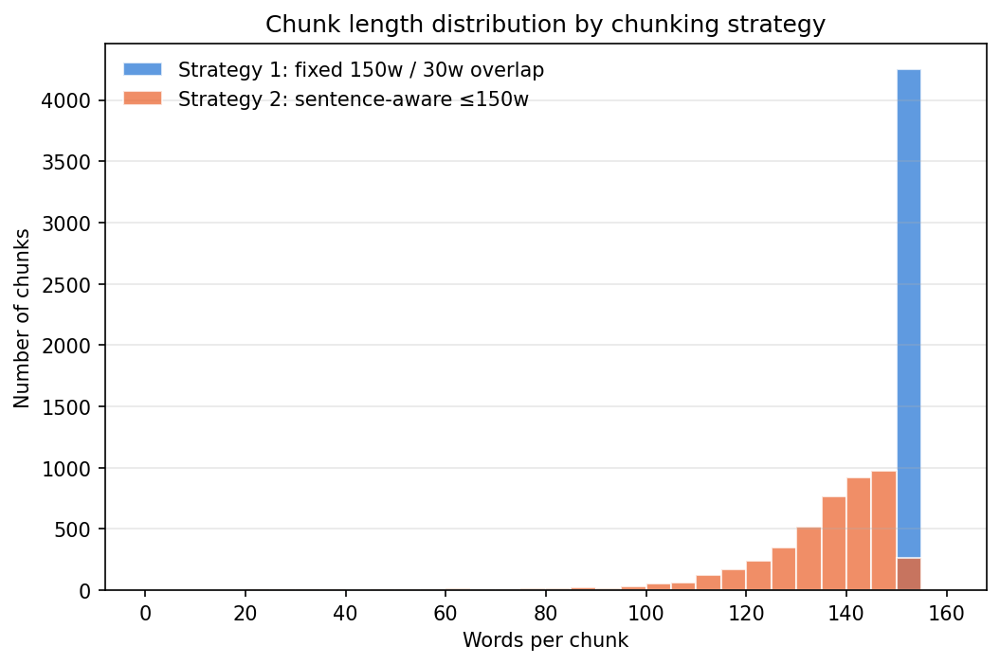
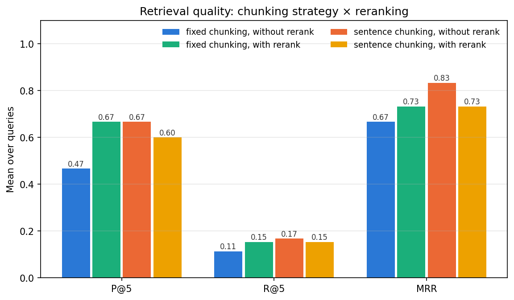
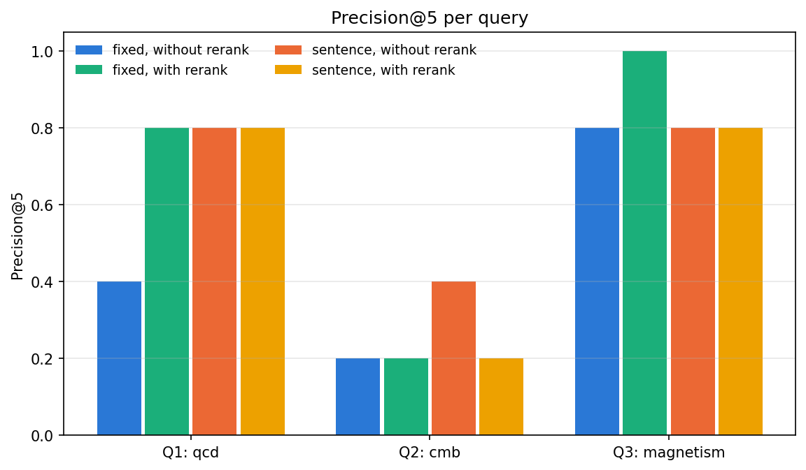
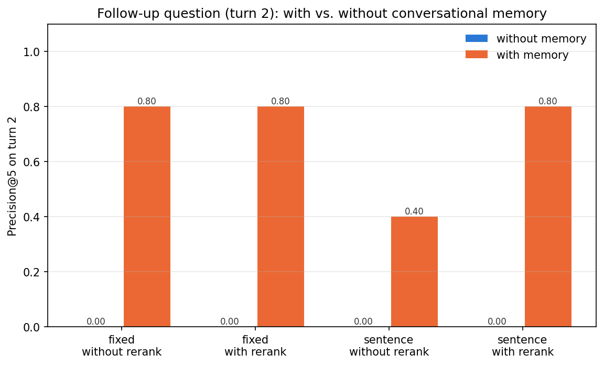

# METRICS — RAG with Reranking, Chunking, and Conversational Memory

## Setup
- Data: `ccdv/arxiv-summarization`, `document` config, train split, first 100 documents (100 non-empty after cleaning)
- Preprocessing: removed `@xmath`/`@xcite` placeholders and figure refs, re-attached punctuation, kept `\n` as section boundary
- Embeddings: `sentence-transformers/all-MiniLM-L6-v2` (L2-normalised) · Vector DB: ChromaDB (one collection per strategy)
- Reranker: `cross-encoder/ms-marco-MiniLM-L-6-v2` re-scoring the top 30 dense candidates
- K = 5 and 10; MRR over top 10; seed = 5937

## Chunking strategies
| strategy   |   n_chunks |   mean_words |   median_words |   min_words |   max_words |   pct_end_mid_sentence |
|:-----------|-----------:|-------------:|---------------:|------------:|------------:|-----------------------:|
| fixed      |       4351 |        148.6 |            150 |          35 |         150 |                   92.3 |
| sentence   |       4644 |        133.6 |            139 |           4 |         150 |                    1.9 |

## Queries
| qid   | topic     | query                                                                                   |
|:------|:----------|:----------------------------------------------------------------------------------------|
| Q1    | qcd       | What does QCD predict about quarks and hadron properties?                               |
| Q2    | cmb       | What do cosmic microwave background measurements tell us about cosmological parameters? |
| Q3    | magnetism | What are the magnetic properties and ordering of spin systems?                          |

Conversation (exoplanet): turn 1 = "How are extrasolar planets detected?", turn 2 = "What are the main sources of uncertainty or error in those measurements?"

**Relevance definition:** a chunk is relevant (useful for answering) if it mentions the query's topic (core terms) and at least
two of the hand-picked aspect terms for that question (turn 2: topic + at least one uncertainty/error term). Core/aspect lists are in the
notebook (Cell 11); 0 individual judgments were overridden manually after reading the chunks.

## Results — per query
| query   | strategy   | reranking   |   n_relevant |   P@5 |   R@5 |   P@10 |   R@10 |   MRR |
|:--------|:-----------|:------------|-------------:|------:|------:|-------:|-------:|------:|
| Q1      | fixed      | without     |           32 |   0.4 | 0.062 |    0.6 |  0.188 |   0.5 |
| Q1      | fixed      | with        |           32 |   0.8 | 0.125 |    0.8 |  0.25  |   1   |
| Q1      | sentence   | without     |           25 |   0.8 | 0.16  |    0.8 |  0.32  |   1   |
| Q1      | sentence   | with        |           25 |   0.8 | 0.16  |    0.7 |  0.28  |   1   |
| Q2      | fixed      | without     |           18 |   0.2 | 0.056 |    0.1 |  0.056 |   0.5 |
| Q2      | fixed      | with        |           18 |   0.2 | 0.056 |    0.1 |  0.056 |   0.2 |
| Q2      | sentence   | without     |           21 |   0.4 | 0.095 |    0.4 |  0.19  |   1   |
| Q2      | sentence   | with        |           21 |   0.2 | 0.048 |    0.2 |  0.095 |   0.2 |
| Q3      | fixed      | without     |           18 |   0.8 | 0.222 |    0.5 |  0.278 |   1   |
| Q3      | fixed      | with        |           18 |   1   | 0.278 |    0.6 |  0.333 |   1   |
| Q3      | sentence   | without     |           16 |   0.8 | 0.25  |    0.6 |  0.375 |   0.5 |
| Q3      | sentence   | with        |           16 |   0.8 | 0.25  |    0.5 |  0.312 |   1   |

## Results — mean over queries
| config                    |   P@5 |   R@5 |   P@10 |   R@10 |   MRR |
|:--------------------------|------:|------:|-------:|-------:|------:|
| fixed / with rerank       | 0.667 | 0.153 |  0.5   |  0.213 | 0.733 |
| fixed / without rerank    | 0.467 | 0.113 |  0.4   |  0.174 | 0.667 |
| sentence / with rerank    | 0.6   | 0.153 |  0.467 |  0.229 | 0.733 |
| sentence / without rerank | 0.667 | 0.168 |  0.6   |  0.295 | 0.833 |

## Results — conversational memory
|   turn | strategy   | reranking   | memory   |   n_relevant |   P@5 |   R@5 |   P@10 |   R@10 |   MRR |
|-------:|:-----------|:------------|:---------|-------------:|------:|------:|-------:|-------:|------:|
|      1 | fixed      | without     | without  |           11 |   0.8 | 0.364 |    0.6 |  0.545 |   1   |
|      2 | fixed      | without     | without  |           17 |   0   | 0     |    0   |  0     |   0   |
|      1 | fixed      | without     | with     |           11 |   0.8 | 0.364 |    0.6 |  0.545 |   1   |
|      2 | fixed      | without     | with     |           17 |   0.8 | 0.235 |    0.6 |  0.353 |   1   |
|      1 | fixed      | with        | without  |           11 |   0.4 | 0.182 |    0.7 |  0.636 |   1   |
|      2 | fixed      | with        | without  |           17 |   0   | 0     |    0   |  0     |   0   |
|      1 | fixed      | with        | with     |           11 |   0.4 | 0.182 |    0.7 |  0.636 |   1   |
|      2 | fixed      | with        | with     |           17 |   0.8 | 0.235 |    0.7 |  0.412 |   1   |
|      1 | sentence   | without     | without  |           12 |   0.8 | 0.333 |    0.6 |  0.5   |   0.5 |
|      2 | sentence   | without     | without  |           14 |   0   | 0     |    0   |  0     |   0   |
|      1 | sentence   | without     | with     |           12 |   0.8 | 0.333 |    0.6 |  0.5   |   0.5 |
|      2 | sentence   | without     | with     |           14 |   0.4 | 0.143 |    0.5 |  0.357 |   1   |
|      1 | sentence   | with        | without  |           12 |   0.2 | 0.083 |    0.5 |  0.417 |   1   |
|      2 | sentence   | with        | without  |           14 |   0   | 0     |    0   |  0     |   0   |
|      1 | sentence   | with        | with     |           12 |   0.2 | 0.083 |    0.5 |  0.417 |   1   |
|      2 | sentence   | with        | with     |           14 |   0.8 | 0.286 |    0.8 |  0.571 |   1   |

## Findings (computed from the tables above)

### 1. Without vs. with reranking
- Fixed chunks: P@5 +0.200, R@5 +0.039, P@10 +0.100, R@10 +0.039, MRR +0.067
- Sentence chunks: P@5 -0.067, R@5 -0.016, P@10 -0.133, R@10 -0.066, MRR -0.100

### 2. Chunking strategy 1 (fixed) vs. strategy 2 (sentence-aware)  [sentence − fixed]
- Without reranking: P@5 +0.200, R@5 +0.055, P@10 +0.200, R@10 +0.122, MRR +0.167
- With reranking: P@5 -0.067, R@5 -0.000, P@10 -0.033, R@10 +0.016, MRR +0.000

### 3. Without vs. with conversational memory (turn 2, mean over 4 configs)  [with − without]
- P@5 +0.700, R@5 +0.225, P@10 +0.650, R@10 +0.423, MRR +1.000
- Turn-2 search query without memory: `What are the main sources of uncertainty or error in those measurements?`
- Turn-2 search query with memory: `How are extrasolar planets detected? What are the main sources of uncertainty or error in those measurements?`

**Best configuration (P@5, then MRR):** sentence / without rerank — P@5 0.667, R@5 0.168, MRR 0.833

## Discussion
- **Reranking.** The bi-encoder embeds query and chunk separately, so it ranks by general topical similarity. The cross-encoder reads the
  query and chunk together and can reward chunks that address the specific *aspect* asked (e.g. *how it is measured*, not just *mentions the topic*).
  Because it only re-orders the top 30, it cannot recover a relevant chunk the dense step missed; any gain shows up mainly in P@5 and MRR.
- **Chunking.** Fixed windows cut 92% of chunks mid-sentence and can merge the end of one section
  with the start of the next, which dilutes the embedding. Sentence-aware chunks keep ideas whole and respect section breaks, but are shorter
  and uneven in length; the overlap in fixed windows also creates near-duplicate neighbours that can crowd the top-K.
- **Memory.** The follow-up never names the topic, so the bare query matches "uncertainty / error" passages from unrelated papers.
  Prepending the previous turn restores the topic, which is why turn-2 precision changes the most of any comparison. The rule-based
  trigger is simple: it would misfire on a new standalone question that happens to contain "this"/"that", and concatenation grows the query
  over long conversations (we cap history at 2 turns). An LLM-based query rewriter would be the next step.
- **Limitations.** Only 3 standalone queries + 1 conversation; relevance is a keyword rubric (consistent, but it can reward
  term overlap and miss paraphrases); Recall@K is low by construction when a topic has many relevant chunks, because K ≤ 10.
