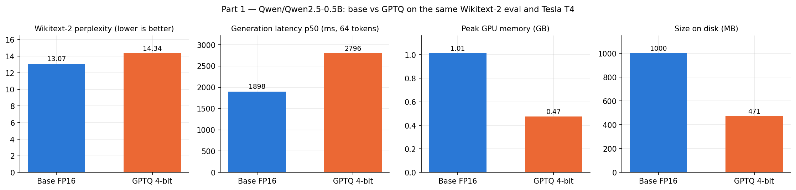
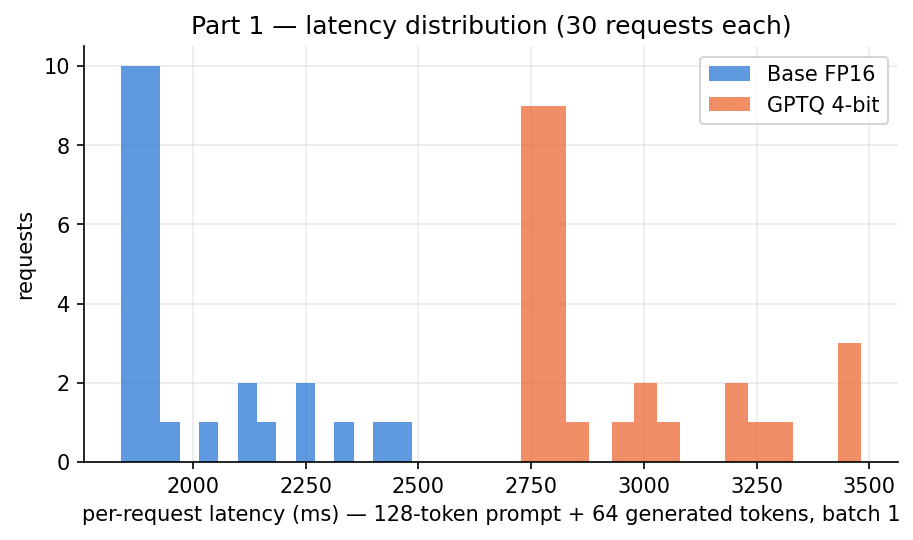

# HW12 — METRICS

<!-- BEGIN part1 -->
## Part 1 — GPTQ quantization (Wikitext-2)

Model: `Qwen/Qwen2.5-0.5B` @ revision `060db6499f32faf8b98477b0a26969ef7d8b9987` · Data: `Salesforce/wikitext` / `wikitext-2-raw-v1` @ `b08601e04326c79dfdd32d625aee71d232d685c3` · GPU: Tesla T4
GPTQ: 4-bit, group size 128, desc_act=False, sym=True,
calibration = 128 × 512-token windows from the **train** split (seed 5937).
Evaluation: **test** split, non-overlapping 2048-token windows (146 windows, 298,862 predicted tokens).
Latency: batch 1, 30 prompts × 128 tokens, greedy, exactly 64 new tokens, 3 warm-up requests.
Peak memory: `torch.cuda.max_memory_allocated` during the latency benchmark. Size: `save_pretrained` folder (base saved in FP16).

**Table HW11.1 — GPTQ comparison on the same LLM/task.**

| Configuration                      |   Quality metric (Wikitext-2 test PPL ↓) | p50 / p95 latency (ms)   |   Peak memory (GB) |   Size on disk (MB) |
|:-----------------------------------|-----------------------------------------:|:-------------------------|-------------------:|--------------------:|
| Base LLM (Qwen/Qwen2.5-0.5B, FP16) |                                   13.07  | 1897.9 / 2385.2          |              1.011 |               999.5 |
| GPTQ-quantized LLM (4-bit, g128)   |                                   14.339 | 2795.9 / 3464.5          |              0.474 |               471.1 |

Additional measurements:

| Configuration   |   eval loss (nats/token) | prefill 512 tok p50 / p95 (ms)   |   ms / generated token (p50) |   peak memory during PPL eval (GB) |   weights only (MB) |
|:----------------|-------------------------:|:---------------------------------|-----------------------------:|-----------------------------------:|--------------------:|
| Base FP16       |                   2.5703 | 33.74 / 37.99                    |                        29.65 |                              4.111 |               988.1 |
| GPTQ 4-bit      |                   2.663  | 51.14 / 57.21                    |                        43.69 |                              3.572 |               459.4 |

Sample greedy continuation of "The history of the Roman Empire":
- Base: 'The history of the Roman Empire is one of the most fascinating in the world. It is a fascinating history because it is the history of the world. It is a history of the world because it is the history of the world.'
- GPTQ: 'The history of the Roman Empire is a fascinating tale of conquest, empire, and the rise of a powerful civilization. The Romans were a diverse group of people who spoke different languages and had different customs, but they all shared a common'

### Part 1 findings

- **Quality cost:** perplexity rose from 13.070 to 14.339 (+9.7%), i.e. eval loss 2.5703 → 2.6630 nats/token.
- **Size:** 1000 MB → 471 MB on disk (2.12× smaller). It is not 4× because GPTQ quantizes only the transformer
  linear layers; the Qwen/Qwen2.5-0.5B embedding matrix (151,936 × 896, tied with the LM head) stays in FP16, and each group of 128 weights also stores a scale and zero point.
- **Peak GPU memory during generation:** 1.011 GB → 0.474 GB (2.13× lower). KV cache and activations stay FP16, so memory shrinks less than the weights.
- **Latency (batch 1, 128-token prompt, 64 new tokens):** p50 1897.9 → 2795.9 ms, p95 2385.2 → 3464.5 ms
  — the GPTQ model is 1.47× slower. Prefill of 512 tokens: 33.74 → 51.14 ms.
  Kernel used: n/a. For a 0.5 B model at batch 1, each decoding step is dominated by per-layer kernel-launch overhead rather than by reading weights, and the 4-bit weights must be dequantized inside the kernel, so GPTQ gives no real speed-up here; its gain is memory and storage.
- **Quantization cost:** 4.2 min on Tesla T4 with 128 calibration windows — no training and no labels.
<!-- END part1 -->
