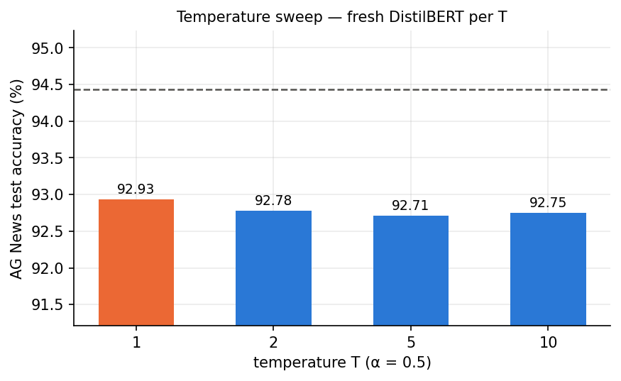
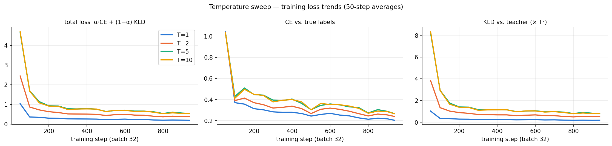
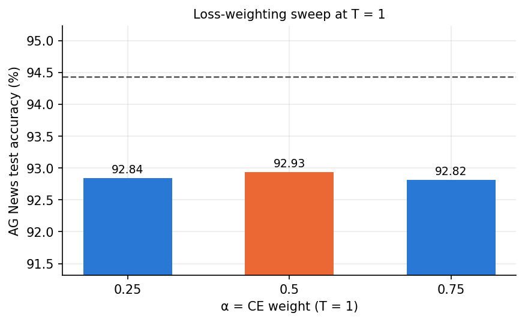
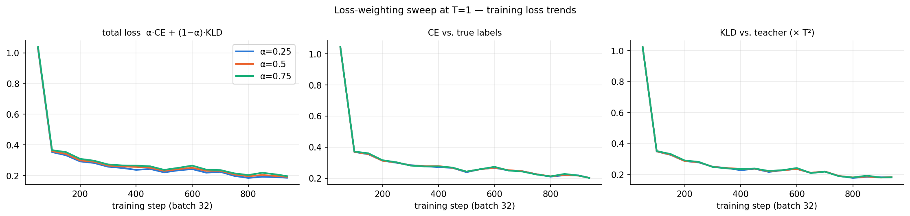
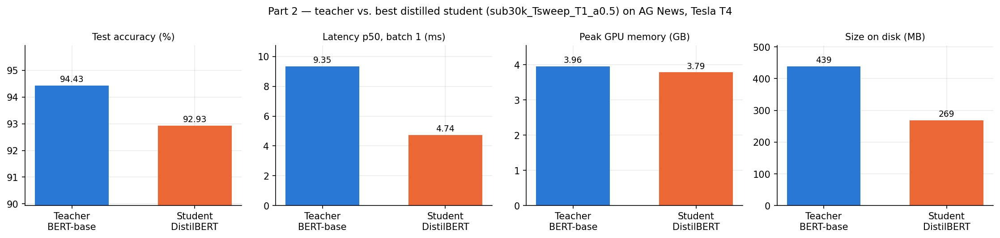
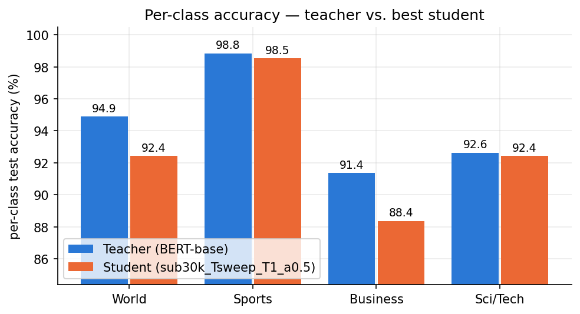
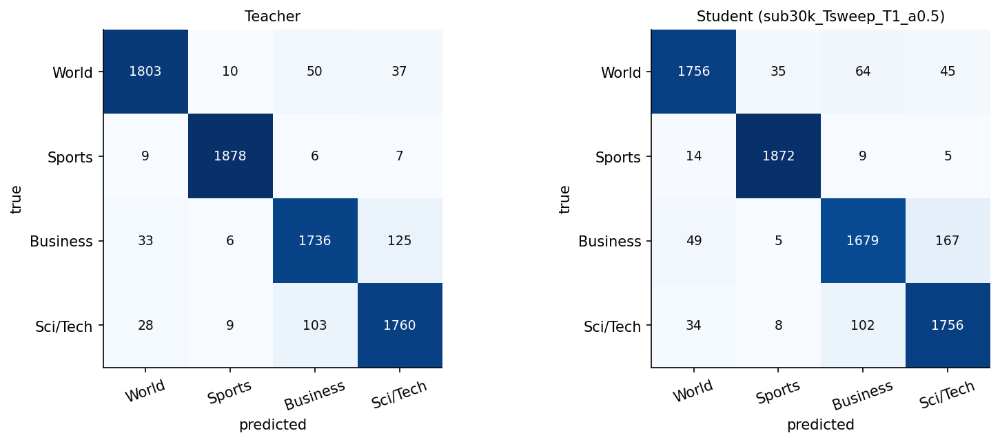

# HW12 — METRICS

<!-- BEGIN part1 -->
## Part 1 — GPTQ quantization (Wikitext-2)

Model: `Qwen/Qwen2.5-0.5B` @ revision `060db6499f32faf8b98477b0a26969ef7d8b9987` · Data: `Salesforce/wikitext` / `wikitext-2-raw-v1` @ `b08601e04326c79dfdd32d625aee71d232d685c3` · GPU: Tesla T4
GPTQ: 4-bit, group size 128, desc_act=False, sym=True,
calibration = 128 × 512-token windows from the **train** split (seed 5937).
Evaluation: **test** split, non-overlapping 2048-token windows (146 windows, 298,862 predicted tokens).
Latency: batch 1, 30 prompts × 128 tokens, greedy, exactly 64 new tokens, 3 warm-up requests.
Peak memory: `torch.cuda.max_memory_allocated` during the latency benchmark. Size: `save_pretrained` folder (base saved in FP16).

**Table HW11.1 — GPTQ comparison on the same LLM/task.**

| Configuration                      |   Quality metric (Wikitext-2 test PPL ↓) | p50 / p95 latency (ms)   |   Peak memory (GB) |   Size on disk (MB) |
|:-----------------------------------|-----------------------------------------:|:-------------------------|-------------------:|--------------------:|
| Base LLM (Qwen/Qwen2.5-0.5B, FP16) |                                   13.07  | 2113.3 / 4758.9          |              1.012 |               999.5 |
| GPTQ-quantized LLM (4-bit, g128)   |                                   14.354 | 5927.8 / 6357.9          |              0.944 |               471.1 |

Additional measurements:

| Configuration   |   eval loss (nats/token) | prefill 512 tok p50 / p95 (ms)   |   ms / generated token (p50) |   peak memory during PPL eval (GB) |   weights only (MB) |
|:----------------|-------------------------:|:---------------------------------|-----------------------------:|-----------------------------------:|--------------------:|
| Base FP16       |                   2.5703 | 39.78 / 51.20                    |                        33.02 |                              4.119 |               988.1 |
| GPTQ 4-bit      |                   2.6641 | 90.79 / 126.39                   |                        92.62 |                              4.039 |               459.4 |

Sample greedy continuation of "The history of the Roman Empire":
- Base: 'The history of the Roman Empire is one of the most fascinating in the world. It is a fascinating history because it is the history of the world. It is a history of the world because it is the history of the world.'
- GPTQ: 'The history of the Roman Empire is one of the most fascinating and complex stories in the history of the world. The Romans were a people who had a unique blend of culture, history, and philosophy. They were also known for their'

### Part 1 findings

- **Quality cost:** perplexity rose from 13.070 to 14.354 (+9.8%), i.e. eval loss 2.5703 → 2.6641 nats/token.
- **Size:** 1000 MB → 471 MB on disk (2.12× smaller). It is not 4× because GPTQ quantizes only the transformer
  linear layers; the Qwen/Qwen2.5-0.5B embedding matrix (151,936 × 896, tied with the LM head) stays in FP16, and each group of 128 weights also stores a scale and zero point.
- **Peak GPU memory during generation:** 1.012 GB → 0.944 GB (1.07× lower). KV cache and activations stay FP16, so memory shrinks less than the weights.
- **Latency (batch 1, 128-token prompt, 64 new tokens):** p50 2113.3 → 5927.8 ms, p95 4758.9 → 6357.9 ms
  — the GPTQ model is 2.81× slower. Prefill of 512 tokens: 39.78 → 90.79 ms.
    Kernel used: torch (GPT-QModel backend; Marlin cannot compile on a T4).
- **Quantization cost:** 1.5 min on Tesla T4 with 128 calibration windows — no training and no labels.
<!-- END part1 -->

<!-- BEGIN part2 -->
## Part 2 — Knowledge distillation (AG News)

Teacher: instructor `teacher_model` (bert, 12 layers, 109.5 M params), loaded locally · Student: `distilbert/distilbert-base-uncased` @ `12040accade4e8a0f71eabdb258fecc2e7e948be`
Data: `fancyzhx/ag_news` @ `eb185aade064a813bc0b7f42de02595523103ca4` (train 120,000 / test 7,600) · GPU: Tesla T4
Loss: `loss = α·CE(student, y) + (1−α)·KLD`, `KLD = KL(softmax(teacher/T) ‖ softmax(student/T))·T²` (T² scaling as in Demo 11).
Teacher logits were extracted once for all 120,000 training samples (`p2_teacher_train_logits.npy`; teacher train accuracy 98.95%).
Every student: fresh from the same pretrained checkpoint, seed 5937, trained on the same seeded 30,000-sample subset of the training set
(`p2_train_subset_idx.npy`, chosen to fit the T4 time budget; teacher logits looked up by original row), 1 epoch over that subset, batch 32, AdamW lr 5e-05,
wd 0.01, 6% warm-up + linear decay, clip 1.0, max len 128, bfloat16 autocast, same data order.

### Temperature sweep (α = 0.5)
|   T |   α | test accuracy   |   final CE |   final KLD |   train time (min) |
|----:|----:|:----------------|-----------:|------------:|-------------------:|
|   1 | 0.5 | 92.93%          |     0.2027 |      0.1815 |                6.1 |
|   2 | 0.5 | 92.78%          |     0.2391 |      0.508  |                6.2 |
|   5 | 0.5 | 92.71%          |     0.2654 |      0.8136 |                6.2 |
|  10 | 0.5 | 92.75%          |     0.265  |      0.7858 |                6.2 |

**Best temperature: T = 1.**

### Loss-weighting sweep (T = 1, three fresh students)
|   T |   α (CE weight) |   1−α (KLD weight) | test accuracy   |   final CE |   final KLD |
|----:|----------------:|-------------------:|:----------------|-----------:|------------:|
|   1 |            0.25 |               0.75 | 92.84%          |     0.2025 |      0.1804 |
|   1 |            0.5  |               0.5  | 92.93%          |     0.2027 |      0.1815 |
|   1 |            0.75 |               0.25 | 92.82%          |     0.202  |      0.1808 |

### Sample training log — best student `sub30k_Tsweep_T1_a0.5` (50-step averages; full logs in `logs/`)
| step   | epoch   | loss   | ce     | kld    | lr       | elapsed_s   |
|:-------|:--------|:-------|:-------|:-------|:---------|:------------|
| 50     | 0.053   | 1.0322 | 1.0420 | 1.0225 | 4.46e-05 | 19.7        |
| 200    | 0.213   | 0.2991 | 0.3127 | 0.2856 | 4.18e-05 | 77.3        |
| 350    | 0.373   | 0.2592 | 0.2779 | 0.2405 | 3.33e-05 | 137.0       |
| 500    | 0.533   | 0.2310 | 0.2425 | 0.2194 | 2.48e-05 | 196.8       |
| 650    | 0.693   | 0.2311 | 0.2523 | 0.2099 | 1.63e-05 | 255.2       |
| 800    | 0.853   | 0.1961 | 0.2126 | 0.1796 | 7.82e-06 | 315.3       |
| 938    | 1.000   | 0.1921 | 0.2027 | 0.1815 | 0.00e+00 | 367.5       |

Loss trend: total loss 1.0322 → 0.1921, CE 1.0420 → 0.2027, KLD 1.0225 → 0.1815
over 938 steps (6.1 min).

### Summary metrics — all 7 distilled students
| run                    | sweep   |   T |    α | test accuracy   |   final CE |   final KLD |   train min |
|:-----------------------|:--------|----:|-----:|:----------------|-----------:|------------:|------------:|
| sub30k_Tsweep_T1_a0.5  | Tsweep  |   1 | 0.5  | 92.93%          |     0.2027 |      0.1815 |         6.1 |
| sub30k_Tsweep_T2_a0.5  | Tsweep  |   2 | 0.5  | 92.78%          |     0.2391 |      0.508  |         6.2 |
| sub30k_Tsweep_T5_a0.5  | Tsweep  |   5 | 0.5  | 92.71%          |     0.2654 |      0.8136 |         6.2 |
| sub30k_Tsweep_T10_a0.5 | Tsweep  |  10 | 0.5  | 92.75%          |     0.265  |      0.7858 |         6.2 |
| sub30k_Asweep_T1_a0.25 | Asweep  |   1 | 0.25 | 92.84%          |     0.2025 |      0.1804 |         6.1 |
| sub30k_Asweep_T1_a0.5  | Asweep  |   1 | 0.5  | 92.93%          |     0.2027 |      0.1815 |         6.2 |
| sub30k_Asweep_T1_a0.75 | Asweep  |   1 | 0.75 | 92.82%          |     0.202  |      0.1808 |         6.2 |

**Table HW11.2 — the separate distillation comparison on AG News.** (best student = `sub30k_Tsweep_T1_a0.5`, T = 1, α = 0.5)

| Configuration                                         | Accuracy   | p50 / p95 latency (ms)   |   Peak memory (GB) |   Size on disk (MB) |
|:------------------------------------------------------|:-----------|:-------------------------|-------------------:|--------------------:|
| Teacher (BERT-base, 109 M params)                     | 94.43%     | 14.84 / 40.89            |              3.956 |               438.7 |
| Best distilled student (DistilBERT, 67 M; T=1, α=0.5) | 92.93%     | 10.81 / 24.37            |              3.956 |               268.6 |

| Configuration   |   test-set inference time (s, batch 256) |   throughput (samples/s) |   weights only (MB) |   parameters (M) |
|:----------------|-----------------------------------------:|-------------------------:|--------------------:|-----------------:|
| Teacher         |                                    56.39 |                      135 |               438   |            109.5 |
| Best student    |                                    26.44 |                      287 |               267.8 |             67   |

Latency: batch 1, 500 seeded test samples, FP32, model call only. Peak memory: batch-256 pass over the full test set. Size: `save_pretrained` folder
(the teacher as delivered in the archive: 438.9 MB).

### Where the compression hurts
| class    | teacher acc   | student acc   | drop (pts)   |
|:---------|:--------------|:--------------|:-------------|
| World    | 94.89%        | 92.42%        | +2.47        |
| Sports   | 98.84%        | 98.53%        | +0.32        |
| Business | 91.37%        | 88.37%        | +3.00        |
| Sci/Tech | 92.63%        | 92.42%        | +0.21        |

Most degraded class: **Business** (+3.00 points). In this class there are 96 test samples the teacher gets right and
the student gets wrong; the student sends them to Sci/Tech (70), World (24), Sports (2).
They average 36.5 words (class average 37.6); the teacher's mean p(true) on them is 0.935
(class average 0.910); the student puts 0.216 on the true class and 0.753 on its wrong answer.

Five examples (true class = Business; teacher right, student wrong; picked with seed 5937):

| test idx | text | teacher p(Business) | student prediction (p) |
|---|---|---|---|
| 110 | Yahoo! Ups Ante for Small Businesses Web giant Yahoo! is gambling that price cuts on its domain name registration and Web hosting products will make it more competitive with discounters in the space -- which means that small businesses looking to move online get a sweeter deal through ... | 0.968 | Sci/Tech (0.930) |
| 1124 | Judge: Geico can sue Google, Overture over ads A federal judge in Virginia has ruled that a trademark infringement suit filed by the Government Employees Insurance Co. (GEICO) against Internet search giants Google Inc. and Overture Services Inc. can proceed. | 0.929 | Sci/Tech (0.748) |
| 3576 | Intel defeats AMD in court AMD #39;s attempt to persuade the US court to sanction the release of over 60,000 pages of Intel documentation to a European Commission anti-trust enquiry has failed. | 0.983 | Sci/Tech (0.869) |
| 4603 | EDS cutting 4,600 jobs through early retirement, taking US\$150M &lt;b&gt;...&lt;/b&gt; PLANO, Tex. (CP) - Electronic Data Systems is cutting 4,600 jobs through early retirement and taking a \$150 million US charge in the fourth quarter, the information technology company said Tuesday. | 0.980 | Sci/Tech (0.519) |
| 5392 | Cisco Systems 1st-Quarter Earnings Rise (Reuters) Reuters - Cisco Systems Inc., the biggest maker\of equipment that directs data over the Internet, on Tuesday\said quarterly earnings rose 29 percent on rising demand for\its networking gear. | 0.845 | Sci/Tech (0.610) |

**What they have in common:** All five are Business news about technology companies (Yahoo, Google/Overture, AMD vs. Intel, EDS, Cisco), and the student labels every one Sci/Tech while the teacher correctly says Business. The stories are about business events — pricing, a trademark lawsuit, an antitrust dispute, layoffs, quarterly earnings — but they are full of tech company and product names. The smaller student appears to key on those tech words, while the 12-layer teacher uses the financial and legal context (profits, charges, court, antitrust) to pick Business. This Business/Sci-Tech overlap is the main place where compressing BERT into DistilBERT costs accuracy.

<!-- END part2 -->

<!-- BEGIN comparison -->
## Quantization vs. distillation

GPTQ keeps the Qwen/Qwen2.5-0.5B architecture and only stores its linear-layer weights in 4 bits, so it cut the model on disk 2.12× and peak GPU memory 1.07× for a +9.8% change in Wikitext-2 perplexity, while batch-1 generation latency changed by 0.36× (slowing it down), because the 4-bit weights must be dequantized inside every matmul and a small model at batch 1 is not limited by weight reads. Distillation instead removes compute: the 6-layer DistilBERT student is 1.63× smaller on disk, uses 1.00× less peak memory and is 1.37× faster at p50 batch-1 latency than its 12-layer BERT teacher, at a cost of -1.50 accuracy points against that same teacher on AG News. The costs are also different in kind: GPTQ needed 1.5 minutes of calibration on unlabeled text and no training, whereas distillation needed teacher logits for 120,000 labeled samples and 43 minutes of student training (30,000 samples per student) across 7 runs, plus a sweep to tune T and α. For a latency-bound deployment I would consider distillation first, because it removes layers, so every forward pass does less work (measured 1.37× faster here vs. 0.36× for GPTQ); for a memory-bound deployment I would consider GPTQ quantization first, because it cuts the bytes per weight with no retraining (measured 1.07× less memory and 2.12× smaller on disk here). The two are complementary: a distilled student can itself be quantized afterwards.
<!-- END comparison -->
