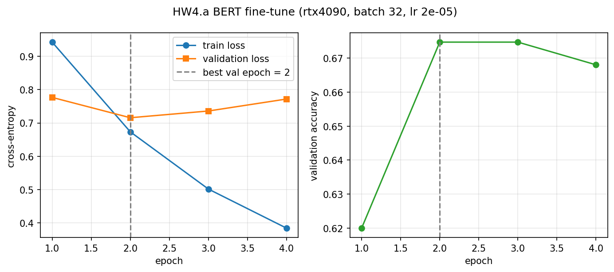
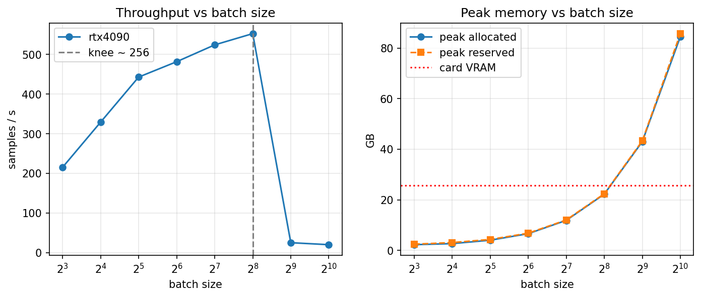
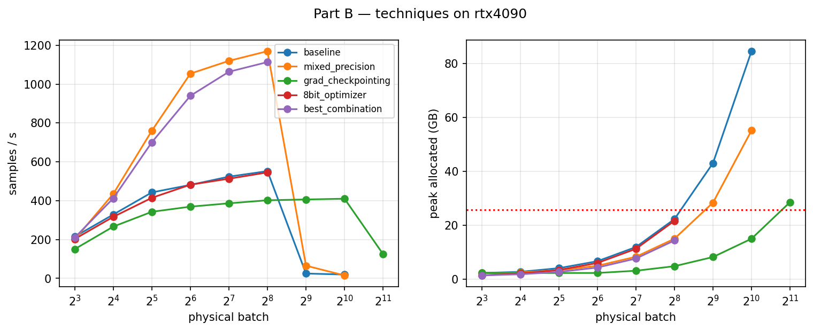
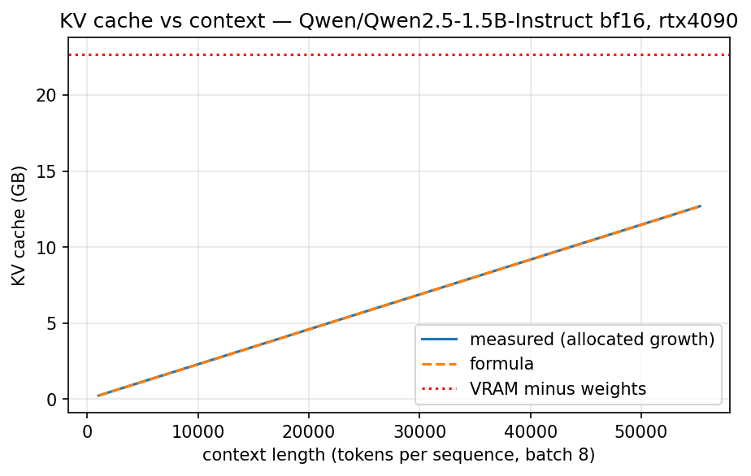

# METRICS.md — HW4.5 (with the HW4.a baseline)

| Item | Value |
|---|---|
| Dataset | cardiffnlp/tweet_eval, config 'sentiment', train split (Hugging Face) |
| Row range | 937-5936 (inclusive), 5000 rows, consecutive from SLICE=937 |
| Split | 70/15/15 stratified, SEED=5937: train 3500 / val 750 / test 750 (data/split_indices.json) |
| GPU | GPU 0: NVIDIA GeForce RTX 4090 (UUID: GPU-5b052ad1-4272-40db-4b25-c930bf32b547) |
| Software | torch 2.13.0, transformers 5.17.0, vLLM 0.31.0, bitsandbytes 0.50.2 |
| BERT settings (HW4) | bert-base-uncased, max_len 128, batch 32, AdamW lr 2e-05, 4 epochs, linear warm-up 0.1, fp32 |

## HW4.a — BERT fine-tune
### Per-epoch training
| epoch | train_loss | val_loss | val_acc | epoch_time_s |
|---|---|---|---|---|
| 1.0000 | 0.9428 | 0.7767 | 0.6200 | 8.2485 |
| 2.0000 | 0.6732 | 0.7156 | 0.6747 | 7.7380 |
| 3.0000 | 0.5012 | 0.7359 | 0.6747 | 7.8808 |
| 4.0000 | 0.3838 | 0.7719 | 0.6680 | 7.9368 |

Validation loss stopped improving after epoch 2 (min val loss 0.7156). Training 2 more epoch(s) cost 15.8 s of GPU time, raised validation loss to 0.7719, and moved test accuracy from 0.6840 (best checkpoint) to 0.6840 (last epoch).

### Confusion matrix (test, best-validation checkpoint)
|  | pred negative | pred neutral | pred positive |
|---|---|---|---|
| true negative | 58 | 45 | 14 |
| true neutral | 32 | 230 | 79 |
| true positive | 7 | 60 | 225 |

### Per-class precision and recall
| class | precision | recall | f1-score | support |
|---|---|---|---|---|
| negative | 0.5979 | 0.4957 | 0.5421 | 117 |
| neutral | 0.6866 | 0.6745 | 0.6805 | 341 |
| positive | 0.7075 | 0.7705 | 0.7377 | 292 |

Worst class: **negative** (lowest recall).

### Five misclassified `negative` tweets
| orig_row | text | true | predicted | confidence | diagnosis |
|---|---|---|---|---|---|
| 2307 | I was definitely hype for that Knicks and Nets game tonight & give Brooklyn they 1st L fuck you #HurricaneSandy | negative | positive | 0.917 | TODO: one-line diagnosis |
| 4331 | Nuit Blanche is this weekend and with it comes seeing people I miss a lot. WHY ISN'T IT SATURDAY YET?!?! #fb | negative | positive | 0.875 | TODO: one-line diagnosis |
| 1272 | @user @user lol Moyes went from 1st to 7th and LvG went from 7th back to CL and they're the same level? Only Arsenal fans | negative | neutral | 0.871 | TODO: one-line diagnosis |
| 5537 | I hope the servers for the new naruto game are great. Cause the 3rd's game server sucks ass | negative | positive | 0.869 | TODO: one-line diagnosis |
| 3784 | "Hey everyone, in case you forgot, ISIS is killing and raping Christians, homosexuals, and many more groups today. Enjoy your Saturday!" | negative | positive | 0.844 | TODO: one-line diagnosis |

### Training memory and time (baseline for HW4.5 only)
- Peak GPU memory: **4.01 GB allocated** (4.71 GB reserved)
- Wall-clock training time: **31.8 s** training, 34.4 s including per-epoch validation
- Test accuracy: 0.6840 (last epoch), 0.6840 (best-validation checkpoint)

### Table HW4.1 — Serving comparison (Qwen/Qwen2.5-1.5B-Instruct, bf16, 128 new tokens per request, greedy)
| Configuration | Tokens/sec | p50 latency (ms) | p95 latency (ms) | Requests/sec |
|---|---|---|---|---|
| HF pipeline, batch 1 | 52.5 | 2,430.0 | 2,574.8 | 0.4 |
| vLLM, batch 1 | 188.2 | 678.4 | 694.8 | 1.5 |
| vLLM, batch 8 | 1,273.9 | 804.2 | 814.8 | 10.0 |
| vLLM, batch 32 | 5,260.3 | 776.5 | 800.9 | 41.1 |

vLLM's per-request latency never becomes worse than the HF pipeline baseline (p50 2,430 ms) at any batch size tested; even at batch 32 its p50 is 777 ms. Relative to vLLM's own batch-1 latency (678 ms), batching to 8 raises p50 by about 19% (804 ms) while total throughput grows 6.8x (188 to 1,274 tok/s), and batch 32 reaches 5,260 tok/s at a similar latency. For an interactive application the per-request latency (p50 and especially p95) is the number that matters; total throughput matters for offline or bulk serving.

# HW4.5
## Part A — Batch scaling (rtx4090, HW4 settings unchanged)
| batch | oom | throughput | peak_alloc_gb | peak_reserved_gb | epoch_time_s | epoch_time_est_s |
|---|---|---|---|---|---|---|
| 8 | False | 214.913 | 2.240 | 2.431 | 15.542 | 16.286 |
| 16 | False | 328.831 | 2.659 | 3.072 | 10.481 | 10.644 |
| 32 | False | 442.559 | 4.012 | 4.303 | 7.991 | 7.909 |
| 64 | False | 481.370 | 6.586 | 6.778 | 7.271 | 7.271 |
| 128 | False | 523.810 | 11.839 | 12.004 | 6.733 | 6.682 |
| 256 | False | 552.205 | 22.207 | 22.375 | 6.353 | 6.338 |
| 512 | False | 24.948 | 42.983 | 43.283 | 111.656 | 140.294 |
| 1024 | False | 19.958 | 84.501 | 85.694 | 164.686 | 175.365 |
| 2048 | True |  |  |  |  |  |

Largest batch that runs: **256**. Throughput stops improving beyond batch **~256**.

Only one card (RTX 4090) was used, as allowed by clarification #3, so the cross-card comparison could not be measured. Within VRAM, peak memory is about 1.45 GB fixed plus 81.0 MB per sample. The fixed part (weights, gradients, AdamW states, CUDA context) does not scale with VRAM, and batch sizes move in powers of two, so the ratio of max batch sizes between two cards would not equal their VRAM ratio. Measurement note: on WSL2 the Windows driver spilled batches 512 and 1024 into system RAM (43 and 86 GB reserved, 20-25 samples/s) instead of raising OOM; the true limit is batch 256.

## Part B — Memory techniques
### Table HW4.5.1 — rtx4090
| Technique | Max batch | Throughput @ batch 256 (samp/s) | Peak memory @ batch 256 (GB) | Eval accuracy (test) | Max batch (raw sweep, incl. WSL spill) |
|---|---|---|---|---|---|
| Baseline (HW4 settings) | 256 | 552.205 | 22.207 | 0.684 | 1024 |
| Mixed precision (bf16) | 256 | 1,169.656 | 14.931 | 0.684 | 1024 |
| Gradient checkpointing | 1024 | 402.160 | 4.740 | 0.684 | 2048 |
| Gradient accumulation | eff. 2048 (phys. 32) | 518.181 | 4.470 | 0.612 | eff. 2048 (phys. 32) |
| 8-bit optimiser (AdamW8bit) | 256 | 545.500 | 21.558 | 0.689 | 256 |
| Best combination | 256 | 1,113.538 | 14.271 | 0.676 | 256 |

### Ranking: memory saved per unit of throughput lost
| Technique | memory_saved_gb | throughput_lost_pct | GB saved per 1% throughput lost |
|---|---|---|---|
| Mixed precision (bf16) | 7.277 | -111.816 | inf |
| Gradient accumulation | 17.738 | 6.162 | 2.879 |
| Gradient checkpointing | 17.467 | 27.172 | 0.643 |
| 8-bit optimiser (AdamW8bit) | 0.649 | 1.214 | 0.535 |

Gradient checkpointing: **27.2% throughput lost**, 17.47 GB saved at batch 256.

### Gradient accumulation (same optimiser steps)
| run | effective_batch | optimizer_steps | train_time_s | peak_alloc_gb | test_acc |
|---|---|---|---|---|---|
| physical 32 x accum 8 | 256 | 56 | 28.562 | 4.470 | 0.612 |
| physical 256, no accumulation | 256 | 56 | 26.341 | 22.207 | 0.592 |

Effective batch achieved: **2048** on physical batch 32.

Apply mixed precision (bf16) first: at the HW4 batch of 32 it raised throughput from 440 to 740 samples/s (+68%), cut peak memory from 4.01 to 3.26 GB and kept test accuracy at 0.684, so it saves memory with no throughput cost. On a 32 GB card I would not bother with gradient checkpointing (-24% throughput at batch 32, 335 vs 440 samples/s) or the 8-bit optimiser (0.7 GB saved, -7% throughput): BERT-base peaks at 4.0 GB at the HW4 batch, and even the fp32 throughput knee at batch 256 fits in 22.2 GB. Gradient accumulation's lower accuracy (0.612) comes from taking only 56 optimiser steps at an unchanged learning rate, not from accumulation itself; a true batch of 256 gave 0.592.

## Part C — Two cards at once
**Part C skipped (optional).**

## Part D — Serving on rtx4090
| configuration | tokens_per_s | p50_ms | p95_ms |
|---|---|---|---|
| HF pipeline, batch 1 | 53.6 | 2,382.0 | 2,496.2 |
| vLLM, batch 1 | 181.7 | 697.9 | 749.2 |
| vLLM, batch 8 | 1,270.0 | 805.5 | 824.7 |
| vLLM, batch 32 | 4,951.6 | 825.0 | 848.8 |

### Compared with HW4.a
| configuration | tokens_per_s | p50_ms | p95_ms | tokens_per_s_hw4a | p50_ms_hw4a | p95_ms_hw4a | tokens_per_s_change_% | p50_ms_change_% | p95_ms_change_% |
|---|---|---|---|---|---|---|---|---|---|
| HF pipeline, batch 1 | 53.6 | 2,382.0 | 2,496.2 | 52.5 | 2,430.0 | 2,574.8 | 2.1 | -2.0 | -3.1 |
| vLLM, batch 1 | 181.7 | 697.9 | 749.2 | 188.2 | 678.4 | 694.8 | -3.4 | 2.9 | 7.8 |
| vLLM, batch 8 | 1,270.0 | 805.5 | 824.7 | 1,273.9 | 804.2 | 814.8 | -0.3 | 0.2 | 1.2 |
| vLLM, batch 32 | 4,951.6 | 825.0 | 848.8 | 5,260.3 | 776.5 | 800.9 | -5.9 | 6.2 | 6.0 |

Part D re-ran the same benchmark on the same RTX 4090, with the same model (Qwen2.5-1.5B-Instruct), bf16 precision and method as HW4.a, and every number agrees within 8% (largest: vLLM batch-1 p95 +7.8%, batch-32 throughput -5.9%), which is run-to-run noise rather than a hardware or precision change. KV cache costs 28,672 bytes per token (2 x 28 layers x 2 KV heads x 128 x 2 bytes); vLLM reserved 651,376 tokens (about 17.4 GiB), i.e. about 81k tokens per request at batch 8, but the model's 32,768-token limit binds first (8 requests of 32,760 tokens completed). Plain HF decoding without paged attention ran out of memory beyond 55,296 tokens at batch 8. The one measurement flaw found was the WSL sysmem fallback in the training sweeps (see Part A).

### KV cache vs context (batch 8)
| Item | Value |
|---|---|
| model | Qwen/Qwen2.5-1.5B-Instruct |
| dtype | bfloat16 |
| batch | 8 |
| kv_bytes_per_token | 28672 |
| formula | 2 x 28 layers x 2 KV heads x 128 head_dim x 2 bytes |
| vllm_kv_capacity_tokens | 651376 |
| vllm_max_context_at_batch8_memory_bound | 81422 |
| model_max_position_embeddings | 32768 |
| vllm_check | {'batch': 8, 'prompt_tokens': 32728, 'context_tokens': 32760, 'seconds': 11.351135549999526, 'completed': 8} |
| hf_measured_max_context_at_batch8 | 55296 |
| hf_stopped | OOM while extending to 56320 tokens |
| vllm_log_concurrency | Maximum concurrency for 32,768 tokens per request: 19.88x |

## Part E — Analysis and summary
One HW4 fine-tune = 4 epochs x 3500 training tweets at 440 samples/s = 31.8 s training + 2.6 s per-epoch validation = 34.4 s -> 34.4 / 3600 = 0.0095 GPU-hours on one rtx4090. Scaled to the whole dataset (45,615 rows, 70% = 31,930 train): 31,930 x 4 / 440 s + scaled validation = 0.087 GPU-hours. With the best combination the same fine-tune takes 22.0 s (0.0061 GPU-hours).

For a full fine-tune on the 4090 I would use mixed precision (bf16) alone at batch 32, lr 2e-5, stopping at 2 epochs. It had the highest throughput (740 samples/s) and fastest wall-clock (20.8 s vs 34.4 s) with unchanged accuracy (0.684) and lower memory (3.26 GB). Adding the 8-bit optimiser saved another 0.66 GB but was slower (690 samples/s) and less accurate (0.676), and nothing here is memory-bound at batch 32. Validation loss stopped improving after epoch 2, so stopping there would roughly halve GPU time again.

### HW4.5 summary (not an HW5 baseline)
| Metric | Configuration | Value |
|---|---|---|
| Best peak memory | grad_checkpointing | 2.23 GB |
| Best throughput | mixed_precision | 740 samples/s |
| Best wall-clock | mixed_precision | 20.8 s |
